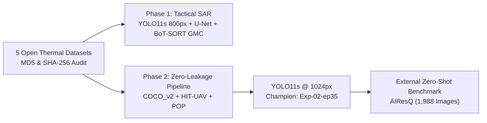
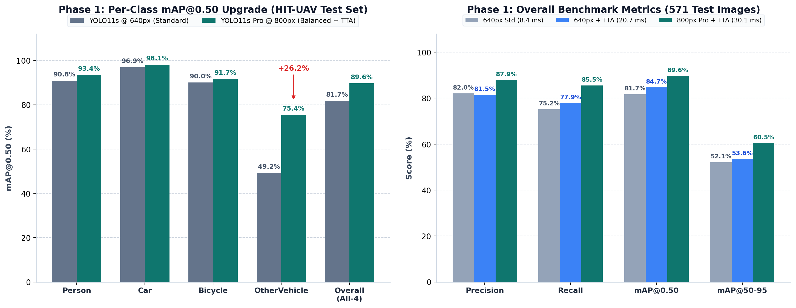
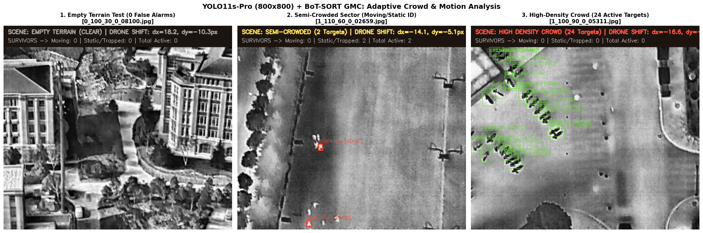
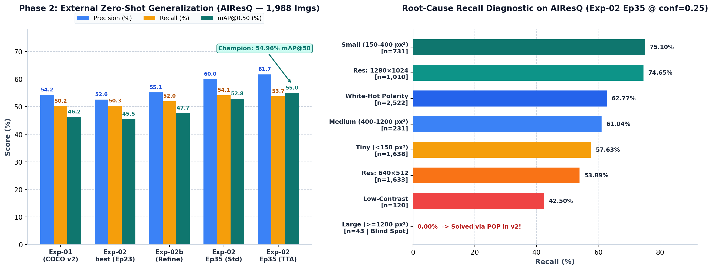
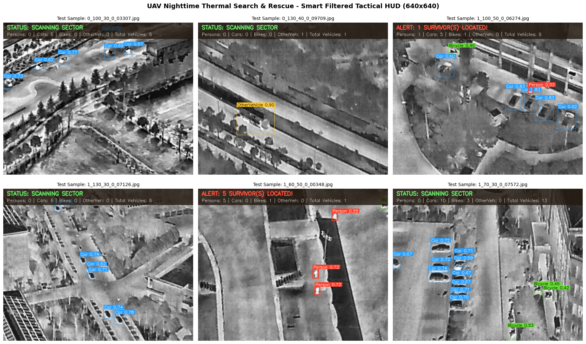

<div align="center">

# AeroTherm-SAR

### نظام الرؤية الحاسوبية الحرارية للبحث والإنقاذ الجوي عبر طائرات الدرون
**Multi-Domain UAV Thermal Computer Vision for Nighttime Search & Rescue**


<br/>

[البيانات والتدقيق الجنائي](docs/DATASETS_AND_AUDIT.md) &nbsp;•&nbsp;
[التجارب والنتائج التفصيلية](docs/EXPERIMENTS_AND_RESULTS.md) &nbsp;•&nbsp;
[النماذج ودليل التشغيل](docs/MODELS_AND_USAGE.md) &nbsp;•&nbsp;
[سجل التجارب](registry/experiments_registry.csv)

</div>

<div dir="rtl">

## نظرة عامة

**AeroTherm-SAR** هو نظام رؤية حاسوبية حرارية متكامل لرصد وتتبع الناجين ليلاً عبر طائرات الدرون (UAV)، مصمم لمعالجة التحديات الحقيقية في البحث والإنقاذ: **الأهداف متناهية الصغر** (`< 1%` من مساحة الصورة)، **حركة الكاميرا الجوية**، و**تعميم النموذج على بيئات جديدة لم يرها أثناء التدريب**.

---

## أبرز النتائج المحققة (Key Highlights)

| المحور | النموذج المعتمد | المقياس الرئيسي | السرعة (`Tesla T4`) |
| :--- | :--- | :---: | :---: |
| **الكشف التكتيكي متعدد الفئات (`HIT-UAV`)** | `YOLO11s-Pro (800×800)` | **`89.63%`** `mAP@50` (`93.38%` للناجين) | `30.1 ms` (~`33 FPS`) |
| **التعميم الخارجي المستقل (`AIResQ Zero-Shot`)** | **`Exp-02-ep35`** (`1024px`) ⭐ | **`52.82%`** قياسي / **`54.96%`** مع `TTA` | `20.2 ms` (~`49 FPS`) |
| **التجزئة الدلالية الحرارية (Pixel-Level)** | `Thermal U-Net (256×256)` | **`98.89%`** Pixel Acc / **`63.65%`** `mIoU` | — |
| **هندسة البيانات بصفر تسرب (`Zero-Leakage`)** | `Unified_SAR_Person_v2` | **`7,550`** صورة و**`23,487`** صندوقاً (`3` مصادر) | جاهز لتدريب `Exp-03` |

---

## مراحل تطور المشروع

1. **المرحلة الأولى — النظام التكتيكي متعدد الفئات (`HIT-UAV`):**
   تحسين التباين الحراري (`CLAHE`)، تصحيح وسوم الفئات الأربع، تدريب `YOLO11s` (`640px` ثم الترقية إلى `800px` المتوازن)، دمج الاستدلال المقطع (`SAHI`)، التجزئة الحرارية (`Thermal U-Net`)، ونظام التتبع **`BoT-SORT + Sparse Optical Flow GMC`** لتعويض حركة الدرون وتصنيف الناجين (متحرك / ساكن).
2. **المرحلة الثانية — التدقيق الجنائي والتعميم عبر النطاقات (`Multi-Domain Benchmark`):**
   توحيد **5 مصادر حرارية مفتوحة** (`+3.03 GB` موثقة بـ `MD5/SHA-256`)، القضاء التام على تسرب الرحلات (`Sequence / Date / Scene Split`)، عزل معيار **`AIResQ` (`1,988` صورة)** كاختبار خارجي صارم، وتشخيص فجوة الأهداف القريبة (`>=1200 px²`) وبناء **`Unified_SAR_Person_v2`** بدمج بيانات **`POP`** استعداداً لـ `Exp-03`.

</div>



<div dir="rtl">

---

## التقنيات والخوارزميات الأساسية

| المجال | التقنيات والخوارزميات |
| :--- | :--- |
| **الكشف والتجزئة** | `YOLO11s` (`C3k2`, `SPPF`, `C2PSA`) • `Custom Thermal U-Net (PyTorch)` |
| **التحسين والاستدلال** | `AdamW` + `Cosine Annealing` • `CLAHE` • `TTA` • `SAHI` • `Agnostic-NMS` |
| **التتبع وتعويض الحركة** | `ByteTrack` • `BoT-SORT` + `Lucas-Kanade Sparse Optical Flow (GMC)` |
| **هندسة وتدقيق البيانات** | `MD5 / SHA-256 Deduplication` • `Zero-Leakage Group Splitting` • `Experiment Registry` |

---

## أبرز المخرجات البصرية والمخططات

### 1. قفزة الأداء في المرحلة الأولى (`HIT-UAV` — `640px` مقابل `800px Pro`)

</div>

<p align="center">
  
</p>

<div dir="rtl">

### 2. نظام التتبع التكتيكي `BoT-SORT + GMC` عبر البيئات الثلاث (فارغة / شبه مزدحمة / مزدحمة)

</div>

<p align="center">
  
</p>

<div dir="rtl">

### 3. التعميم الخارجي والتشخيص الجذري على معيار `AIResQ` (`1,988` صورة مستقلة)

</div>

<p align="center">
  
</p>

<div dir="rtl">

### 4. لوحة الفحص الميداني بالفلتر الذكي لعتبات الثقة (`Smart Filtered Tactical HUD`)

</div>

<p align="center">
  
</p>

<div dir="rtl">

---

## التوثيق التفصيلي (Deep-Dive Documentation)

تم تنظيم كافة التفاصيل التقنية والجداول الشاملة في ملفات مستقلة:

| الملف | المحتوى التفصيلي |
| :--- | :--- |
| **[`docs/DATASETS_AND_AUDIT.md`](docs/DATASETS_AND_AUDIT.md)** | تفاصيل المصادر الخمسة الخام وحجمها، نتائج التدقيق الجنائي (`MD5/SHA-256`)، وهندسة النسخ الثلاث الخالية من التسرب (`v1/v2`) |
| **[`docs/EXPERIMENTS_AND_RESULTS.md`](docs/EXPERIMENTS_AND_RESULTS.md)** | جداول الفئات الكاملة، منحنيات التدريب، نتائج `Thermal U-Net`، سجل تجارب المرحلة الثانية، واختبار استئصال الاستدلال |
| **[`docs/MODELS_AND_USAGE.md`](docs/MODELS_AND_USAGE.md)** | جدول الأوزان المدربة (`Checkpoints`)، التثبيت، أوامر تشغيل `src/infer.py` و`src/track_botsort.py`، وخارطة الطريق (`Exp-03`) |
| **[`notebooks/YOLO_Computer_Vision.ipynb`](notebooks/YOLO_Computer_Vision.ipynb)** | الدفتر الهندسي الكامل الذي يضم جميع مراحل التدريب والتدقيق والتقييم |

---

## التشغيل السريع (Quick Start)

</div>

```bash
git clone https://github.com/Ahmed-Al-Masqari/AeroTherm-SAR.git
cd AeroTherm-SAR
pip install -r requirements.txt

# الاستدلال الفوري بالنموذج البطل (Exp-02-ep35 @ 1024px)
python src/infer.py --weights weights/exp02_ep35_champion_1024.pt --source sample_thermal.jpg --imgsz 1024 --tta
```

<div dir="rtl">

---

## المطوّر والترخيص

- **المطوّر:** Ahmed Al-Masqari — [`@Ahmed-Al-Masqari`](https://github.com/Ahmed-Al-Masqari)
- **الترخيص:** [MIT License](LICENSE)

</div>
