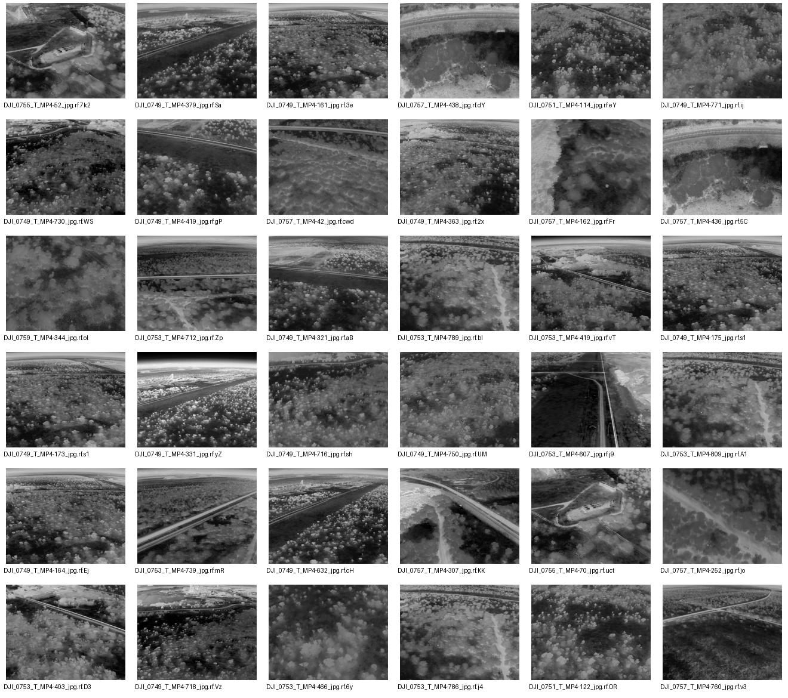

[⬅️ العودة إلى الصفحة الرئيسية (`README.md`)](../README.md)

# مجموعات البيانات والتدقيق الجنائي (Datasets & Forensic Integrity Audit)

## 1. المصادر الخام المعتمدة والموثقة (`Read-Only MD5 / ZIP Verified`)

| مجموعة البيانات | المصدر / المعرّف | الحجم الخام | عدد الصور / الفيديوهات | عدد الصناديق | الخصائص الفيزيائية | الدور المعتمد |
| :--- | :--- | :---: | :---: | :---: | :--- | :--- |
| **HIT-UAV v1.2.1** | Zenodo `7633134` | `777.01 MB` | `2,898` صورة فريدة (`11,592` إجمالاً) | `12,312` Person (`24,751` للـ 4 فئات) | `640×512`، ارتفاعات `60–130m`، حضري ليلي | المرحلة 1 + `Normal` مفصول بالتاريخ في المرحلة 2 |
| **UAV Thermal Human Detection (COCO)** | Zenodo `21515906` | `307.60 MB` | `3,807` صورة خام (`2,344` موسومة) | `3,429` `person` | تصوير مائل، `99.8%` من الأهداف `< 0.1%` من الصورة | نواة التدريب المائل في `COCO_v2` و`Unified_v1/v2` |
| **AIResQ Benchmark** | Zenodo `17405074` | `1,534.63 MB` | `1,988` صورة (`1,660` موجبة + `328` فارغة) | `2,643` `person` | `1280×1024` (`1,067`) و`640×512` (`921`)، `95.4% White-Hot` | **معيار اختبار خارجي مستقل (Zero-Shot Benchmark)** |
| **POP Dataset** | OSF Repository | أرشيف `POP.zip` | `8,768` صورة (`19` مشهداً: `F1–F16`, `T1–T3`) | `26,811` `person` | `1280×1024`، `30–70m`، `96.6%` أهداف قريبة/متوسطة وحجب أشجار | سد فجوة الأهداف القريبة في `Unified_SAR_Person_v2` |
| **UAV Thermal Videos** | Zenodo `4327118` | `410.99 MB` | `3` مقاطع (`DJI_0003`, `0024`, `0026.mov`) | بث حراري حقيقي | `640×512` (`H.264`، `DJI_0026`: `10,432` إطاراً) | التقييم الميداني المستقبلي على بث الدرون |

---

## 2. نتائج التدقيق الجنائي لمنع التسرب (Zero-Leakage Audit)

- **HIT-UAV:** إثبات أن مجموعات التكرار الـ `2,898` هي أزواج `normal/rotate`، وكشف تسرب **`105/105`** جلسة طيران في التقسيم الرسمي -> تم حله بالفصل الصارم حسب تاريخ الالتقاط (`date_captured`) واستبعاد `18` صورة `DontCare` فقط.
- **UAV-COCO:** إزالة **`20`** نسخة مكررة متطابقة ببصمة `SHA-256` (`IDENTICAL_ANNOTATIONS`)، تصحيح `5` صناديق خارج الحدود، عزل `1,443` صورة غير موسومة للمراجعة البصرية، والقضاء على تسرب **`7/7`** مقاطع فيديو بالفصل حسب المقطع (`Group-by-Sequence`).
- **POP:** نظافة **`100%`** (`0` تكرار `MD5`، `0` تسرب مشاهد عبر الـ `19` مشهداً، `0` صناديق تالفة).
- **AIResQ:** أثبتت المعاينة البصرية وجود أشخاص غير موسومين داخل بعض الملفات الفارغة الـ `328` (مثل `DJI_0807_T.JPG` و`DJI_0803_T.JPG`)، ما يفسر جزءاً من معدل الإنذارات المحسوب على الملفات الفارغة.

---

## 3. مجموعات البيانات المهندسة والخالية من التسرب

| النسخة المهندسة | الحجم | سياسة منع التسرب | `Train` (صور / صناديق) | `Val` (صور / صناديق) | `Test` (صور / صناديق) | نسبة الخلفيات السلبية (`Train`) |
| :--- | :---: | :--- | :---: | :---: | :---: | :---: |
| **`COCO_YOLO_v2_CleanSplit`** | `207.3 MB` | `5` مقاطع تدريب، `DJI_0753` تحقق، `DJI_0759` اختبار | `1,812` / `2,732` | `398` / `398` | `299` / `299` | `9.11%` (`165` صورة) |
| **`Unified_SAR_Person_v1`** | `358.1 MB` | `COCO_v2` + `HIT-UAV Normal` (`7` أيام / `20210116` / `20210114`) | `3,606` / `12,558` | `713` / `1,572` | `461` / `1,611` | `17.89%` (`645` خلفية) |
| **`Unified_SAR_Person_v2`** | `550.4 MB` | توازن ثلاثي (~`33%` لكل مصدر): `COCO` + `HIT-UAV` (`+270` خلفية) + `POP` (`Uniform Striding`) | **`5,676`** / **`18,545`** | **`1,113`** / **`2,721`** | **`761`** / **`2,221`** | **`16.12%`** (`915` خلفية) |

### لوحة المراجعة البصرية للصور غير الموسومة في `UAV-COCO`

  

