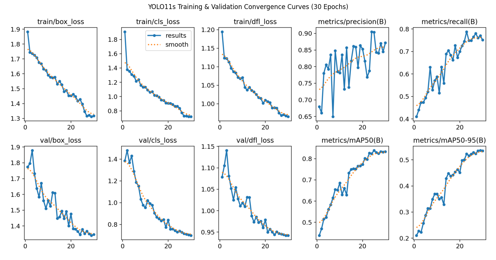
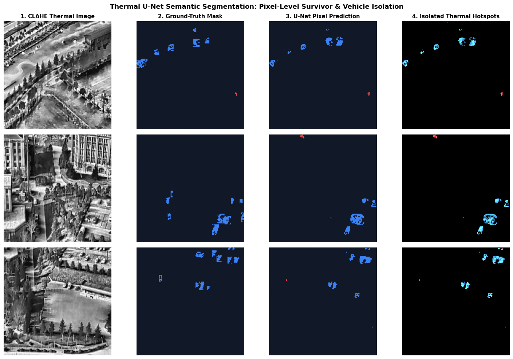

[⬅️ العودة إلى الصفحة الرئيسية (`README.md`)](../README.md)

# التجارب والنتائج التفصيلية (Experiments & Detailed Benchmarks)

## 1. المرحلة الأولى — الكشف التكتيكي متعدد الفئات (`HIT-UAV Test Set` — `571` صورة، `4,780` هدفاً)

| النموذج / وضع الاستدلال | الدقة | `Precision` | `Recall` | `mAP@0.50` | `mAP@50-95` | السرعة (`T4`) |
| :--- | :---: | :---: | :---: | :---: | :---: | :---: |
| `YOLO11s` قياسي (`Standard`) | `640×640` | `82.03%` | `75.17%` | `81.73%` | `52.07%` | `8.4 ms` (~`119 FPS`) |
| `YOLO11s` مع `TTA` | `640×640` | `81.51%` | `77.86%` | `84.73%` | `53.56%` | `20.7 ms` (~`48 FPS`) |
| `YOLO11s` (`Calibrated TTA + Agnostic-NMS`) | `640×640` | `85.30%` | `78.00%` | `80.28%` (`93.03%` Core-3) | `49.50%` | `20.2 ms` (~`50 FPS`) |
| **`YOLO11s-Pro` (متوازن + `TTA`)** | **`800×800`** | **`87.90%`** | **`85.50%`** | **`89.63%`** | **`60.48%`** | **`30.1 ms`** (~`33 FPS`) |

### تفصيل الدقة لكل فئة (`640px Standard` مقابل `800px Pro + TTA`)

| الفئة | `640px Std` (`mAP@50`) | `800px Pro` (`mAP@50`) | التحسن (`Δ`) | `800px Pro` (`P` / `R`) | `800px Pro` (`mAP@50-95`) |
| :--- | :---: | :---: | :---: | :---: | :---: |
| **Person** | `90.81%` | **`93.38%`** | `+2.57%` | `89.18%` / `88.35%` | `51.43%` |
| **Car** | `96.89%` | **`98.07%`** | `+1.18%` | `92.32%` / `97.16%` | `73.45%` |
| **Bicycle** | `90.01%` | **`91.65%`** | `+1.64%` | `91.73%` / `82.16%` | `58.80%` |
| **OtherVehicle** | `49.21%` | **`75.42%`** | **`+26.21%`** | `78.34%` / `74.49%` | `58.25%` |

### منحنيات التقارب أثناء التدريب (`30 Epochs` — `YOLO11s`)

  

---

## 2. نتائج التجزئة الدلالية الحرارية (`Thermal U-Net` — `12` حقبة)

| المقياس (`Test Set = 150 images`) | القيمة |
| :--- | :---: |
| **دقة البكسلات الكلية (`Pixel Accuracy`)** | **`98.89%`** |
| **متوسط التداخل القياسي (`Overall mIoU`)** | **`63.65%`** |
| **Dice — Background / Vehicle / Survivor** | `0.9944` / `0.7311` / `0.5125` |

  

---

## 3. المرحلة الثانية — سجل تجارب التعميم الخارجي (`AIResQ Zero-Shot` — `1,988` صورة)

| التجربة | بيانات التدريب | الاختبار الداخلي (`mAP@50`) | `AIResQ P` | `AIResQ R` | `AIResQ mAP@50` | `AIResQ mAP@50-95` | `Empty FP@0.25` |
| :--- | :--- | :---: | :---: | :---: | :---: | :---: | :---: |
| **`Exp-01`** | `COCO_YOLO_v2_CleanSplit` | `99.45%` | `54.25%` | `50.17%` | `46.23%` | `20.18%` | `45.43%` |
| **`Exp-02 (best Ep23)`** | `Unified_SAR_Person_v1` | `91.39%` | `52.57%` | `50.28%` | `45.46%` | `19.52%` | `75.00%` |
| **`Exp-02b (Refine)`** | `Unified_v1` (`mosaic=0.0`, `scale=0.65`) | `86.45%` / `91.52%` | `55.12%` | `51.99%` | `47.68%` | `21.16%` | — |
| **`Exp-02-ep35 (Std)`** | **`Unified_v1` (`last.pt`, `Ep 35`)** | — | **`60.00%`** | **`54.11%`** | **`52.82%`** | **`23.85%`** | `61.89%` |
| **`Exp-02-ep35 (TTA)`** ⭐ | **`Unified_v1` (`Ep 35` + `TTA`)** | — | **`61.70%`** | **`53.73%`** | **`54.96%`** | **`25.34%`** | — |

### اختبار استئصال الاستدلال (`Inference Ablation` على النموذج البطل `Exp-02-ep35`)

| الوضع | `Precision` | `Recall` | `mAP@0.50` | `mAP@50-95` | السرعة (`T4`) | القرار |
| :--- | :---: | :---: | :---: | :---: | :---: | :--- |
| **`Standard 1024px`** | `60.00%` | `54.11%` | `52.82%` | `23.85%` | **`20.20 ms`** (~`49 FPS`) | معتمد للبث المباشر |
| **`TTA 1024px`** ⭐ | **`61.70%`** | `53.73%` | **`54.96%`** | **`25.34%`** | `45.72 ms` (~`22 FPS`) | معتمد للمراجعة الدقيقة |
| `High-Res 1280px` | `53.04%` | `49.22%` | `44.38%` (`-8.44%`) | `20.75%` | `29.60 ms` | مُستبعد (تضارب المقياس) |

### الدروس الهندسية الموثقة تجريبياً
1. **الاختبار الخارجي ضرورة لا غنى عنها:** سجل `Exp-01` دقة `99.45%` داخلياً مقابل `46.23%` فقط على `AIResQ`.
2. **`Mosaic` يمنع التخصّص النطاقي (`Domain Overfitting`):** إغلاق `Mosaic` في `Exp-02b` أبقى الاختبار الداخلي `91.52%` لكنه خفّض `AIResQ` إلى `47.68%`.
3. **تشخيص السبب الجذري:** كشف التشخيص عن `0.00% Recall` للأهداف القريبة (`>=1200 px²`)، ما أثبت الحاجة لدمج `POP` في `Unified_SAR_Person_v2` لإطلاق `Exp-03`.

